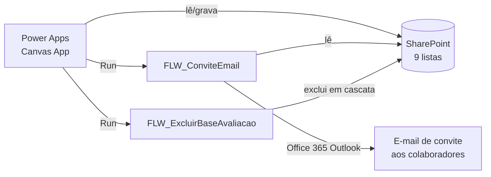

# Avaliação de Colaboradores — Power Apps


Aplicativo de **avaliação de desempenho** para RH: o administrador cria um ciclo de avaliação, define as competências avaliadas e convida os colaboradores; cada colaborador define suas **metas** e faz a **autoavaliação**, o gestor avalia o time e, por fim, a nota é **calibrada**. Tudo roda em Microsoft 365 (Power Apps + Power Automate + SharePoint), sem licença premium.

> Os dados de exemplo deste repositório são fictícios (`contoso.sharepoint.com`). Nenhuma informação de cliente foi mantida.

---

## Funcionalidades

| Perfil | O que faz |
|---|---|
| **Administrador** | Cria a avaliação (nome, período, datas de metas e de avaliação), cadastra os itens/competências por categoria, seleciona os colaboradores participantes e envia o convite por e-mail. Pode **simular o acesso** de qualquer colaborador para suporte. |
| **Colaborador** | Define metas com **pesos** (o app valida se a soma fecha 100%), faz a autoavaliação das competências (escala de 1 a 3) e comenta cada item. |
| **Gestor** | Avalia cada colaborador do seu time, comenta e conclui a avaliação. |
| **Calibração** | Registra a nota final (calibrada) de competências e metas e encerra o ciclo. |

Outros destaques:
- **Fluxo por status** (10 → 50): convite → definição de metas → metas definidas → avaliação (colaborador e gestor) → calibração e conclusão.
- **Controle por datas**: o app bloqueia etapas fora do período configurado.
- **Relatório em HTML** da avaliação, pronto para impressão/PDF.
- **Tema claro/escuro** com paleta centralizada em *Named Formulas* (`CoresLight`, `TextCoresLight`).
- **Componentes reutilizáveis**: loading, estado vazio e toast de confirmação.
- **Variáveis de ambiente** para site e listas — a solução muda de ambiente sem editar o app.

## Arquitetura



| Fluxo | Gatilho | O que faz |
|---|---|---|
| `FLW_ConviteEmail` | Power Apps (IdAvaliacao, e-mails) | Busca a avaliação e envia o convite em cópia oculta a todos os participantes. |
| `FLW_ExcluirBaseAvaliacao` | Power Apps (IdAvaliacao) | Exclui em cascata avaliações, respostas, itens e metas ligados ao ciclo. |

O modelo de dados (listas e colunas) está em [`docs/estrutura-dados.md`](docs/estrutura-dados.md).

## Estrutura do repositório

```
├── solution/
│   └── AvaliacaoColaboradores_1_0_0_2_managed.zip   # solução pronta para importar
├── src/
│   ├── canvas-app/              # código do app em YAML (telas e componentes)
│   ├── flows/                   # definição dos fluxos do Power Automate (JSON)
│   ├── environment-variables/   # variáveis de ambiente (site e listas)
│   └── solution/                # manifesto da solução
└── docs/
    ├── como-implantar.md
    ├── estrutura-dados.md
    └── screenshots/
```

## Como implantar

Resumo — o passo a passo completo está em [`docs/como-implantar.md`](docs/como-implantar.md):

1. Crie um site do SharePoint e as 9 listas descritas em `docs/estrutura-dados.md`.
2. Importe `solution/AvaliacaoColaboradores_1_0_0_2_managed.zip` no Power Apps (**Soluções → Importar**).
3. Na importação, crie as conexões (SharePoint, Office 365 Outlook, Usuários do Office 365) e preencha as variáveis de ambiente com o seu site e listas.
4. Ative os fluxos e compartilhe o app.

## Tecnologias

Power Apps (Canvas, Power Fx, Named Formulas, componentes) · Power Automate · SharePoint Online · Office 365 Outlook · Office 365 Users · Soluções gerenciadas e variáveis de ambiente.

## Créditos

- Os componentes de interface `cmpToastConfirm` e os botões com ícone SVG são baseados em material da **Comunidade Mundo Power** (Daniel Petrin) e mantêm o aviso de autoria original no código.
- Ícones: [Ionic Icons](https://ionic.io/ionicons) — licença MIT.

## Autor

**Luiz Fernando** — desenvolvedor Power Platform · [github.com/Luiz0032](https://github.com/Luiz0032)
